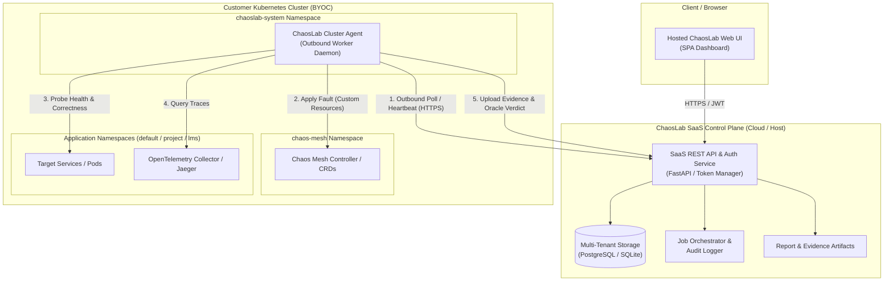

# ChaosLab Hosted Resilience Testing Platform — Architecture & Foundation

## 1. Executive Summary

ChaosLab is evolving from a local CLI-driven chaos engineering tool into a **hosted multi-tenant Resilience Testing Platform (SaaS)**. The platform enables engineering teams to continuously test, verify, and monitor the fault tolerance of their distributed microservices against real-world infrastructure failures.

This architecture specification implements **Option A: Bring Your Own Cluster (BYOC)**:
- Developers register their organizations and applications on the hosted platform.
- Users connect their own Kubernetes clusters (EKS, GKE, AKS, KinD, Minikube) using a **lightweight, outbound-only ChaosLab Agent**.
- The SaaS Control Plane dispatches declarative resilience experiments to enrolled clusters.
- The ChaosLab Agent executes faults via Chaos Mesh, probes target services, collects OpenTelemetry traces, and invokes the **ChaosLab Verification Oracle**.
- Genuine verification results, recovery metrics, and evidence reports are transmitted back to the Control Plane for persistent visualization, compliance gating, and historical analysis.
- **Local execution mode is strictly preserved**: developers can continue running experiments directly via CLI (`python chaoslab/runner.py run <experiment>`).

---

## 2. High-Level System Architecture



---

## 3. Core System Components

### 3.1. SaaS Control Plane (`chaoslab/platform/backend`)
- **Authentication & Authorization**:
  - Secure user registration, credential hashing (salted PBKDF2/SHA-256), and session handling via JSON Web Tokens (JWT).
  - Role-based access control (Admin, Developer, Viewer).
- **Application Registry**:
  - Organizes services under multi-tenant application boundaries.
  - Tracks service endpoints, target namespaces, git repository URLs, and health-check definitions.
- **Cluster Management Hub**:
  - Issues cryptographic, short-lived **One-Time Enrollment Tokens** for Kubernetes clusters.
  - Manages cluster status (`pending`, `active`, `offline`, `degraded`) based on periodic agent heartbeats.
- **Job Dispatcher & Scheduler**:
  - Queues experiment jobs submitted from the UI or CI/CD pipelines.
  - Matches jobs to target enrolled clusters via tenant and cluster identifiers.
- **Evidence & Report Store**:
  - Ingests structured JSON verification reports, HTML dashboards, and Markdown summaries.
  - Enforces audit logging for all disruptive chaos actions.

### 3.2. Hosted Web Dashboard (`chaoslab/platform/frontend`)
- **Modern Responsive Control Center**:
  - Dark-mode SaaS UI inspired by modern cloud dashboards.
- **Authentication Views**:
  - Registration, Login, and User Profile.
- **Application Management**:
  - Register new applications, manage services, view health statuses.
- **Cluster Connection Wizard**:
  - 1-click token generation with copyable `kubectl apply` commands for immediate agent enrollment.
- **Experiment Launch Studio**:
  - Select application -> Choose connected cluster -> Pick experiment template -> Trigger remote run.
- **Live Execution & Verification Center**:
  - Real-time phase tracking (`baseline` -> `injecting` -> `impact` -> `recovering` -> `probing` -> `verifying`).
  - Interactive Oracle Scorecard displaying invariant evaluation (Pass/Fail/SLA margins).
  - Report viewer and download center (HTML, JSON, Markdown).

### 3.3. Lightweight Kubernetes Cluster Agent (`chaoslab/platform/agent`)
- **Outbound-Only Architecture**:
  - Connects out to the SaaS Control Plane over standard HTTPS (TLS 443).
  - Requires **zero open inbound ports, zero ingresses, and zero external load balancers** on the customer cluster.
- **Secure Cluster Enrollment**:
  - Uses a single-use enrollment token on initial bootstrap to securely register the cluster.
  - Receives a scoped Agent API token persisted in a Kubernetes secret.
- **Heartbeat Daemon**:
  - Periodically transmits cluster health metrics (nodes, active pods, Chaos Mesh operational status).
- **Execution Engine**:
  - Polls for queued experiment jobs.
  - Invokes ChaosLab's internal verification engine (`engine.verify_experiment`) locally in the cluster.
  - Enforces security guardrails: rejects arbitrary shell execution; only processes validated declarative experiment specs.
- **Evidence Upload**:
  - Transmits complete Oracle results, logs, and trace spans back to SaaS.

### 3.4. Universal Verification Engine & Oracle (`chaoslab/verifier`)
- Reusable core engine preserved from the standalone system:
  - **Baseline Prober**: Validates cluster health before injection.
  - **Fault Injector**: Deploys Chaos Mesh CRDs (`PodChaos`, `NetworkChaos`).
  - **Telemetry Collector**: Fetches spans and latency metrics from OpenTelemetry / Jaeger.
  - **Verification Oracle**: Deterministically evaluates 10+ invariants across target impact, recovery latency, functional correctness, and error spikes.
  - **Report Generator**: Produces JSON, HTML, and Markdown artifacts.

---

## 4. Module & Directory Layout

```
ChaosLab-Platform/
├── chaoslab/
│   ├── runner.py                    # Preserved local CLI runner
│   ├── gate.py                      # Preserved quality gate
│   ├── experiments/                 # Declarative YAML experiments
│   ├── reports/                     # Report output directory
│   ├── verifier/                    # Preserved verification engine
│   │   ├── engine.py
│   │   ├── oracle.py
│   │   ├── probes.py
│   │   ├── reporter.py
│   │   └── telemetry.py
│   │
│   ├── docs/                        # Architecture & technical specifications
│   │   └── hosted_platform_architecture.md
│   │
│   └── platform/                    # Hosted Platform Implementation
│       ├── __init__.py
│       ├── backend/                 # SaaS Control Plane REST API
│       │   ├── __init__.py
│       │   ├── server.py            # API Server entrypoint
│       │   ├── database.py          # SQLite/PostgreSQL ORM & Schema
│       │   ├── auth.py              # Password hashing & JWT manager
│       │   └── routes/              # Route handlers
│       │       ├── auth_routes.py
│       │       ├── app_routes.py
│       │       ├── cluster_routes.py
│       │       ├── experiment_routes.py
│       │       └── agent_routes.py
│       │
│       ├── frontend/                # Hosted Web Dashboard
│       │   ├── static/
│       │   │   ├── index.html       # Single Page Application
│       │   │   ├── app.js           # Frontend application logic
│       │   │   └── styles.css       # SaaS design stylesheet
│       │
│       └── agent/                   # ChaosLab Cluster Agent
│           ├── __init__.py
│           ├── agent.py             # Agent daemon loop & job runner
│           └── k8s/                 # Kubernetes deployment manifests
│               ├── agent-rbac.yaml
│               ├── agent-secret.yaml
│               └── agent-deployment.yaml
│
├── tests/
│   ├── test_saas_backend.py         # Automated backend tests
│   └── test_e2e_platform.py         # End-to-end integration tests
│
├── Dockerfile.platform              # Control Plane container image
├── Dockerfile.agent                 # Cluster Agent container image
├── docker-compose.platform.yaml     # Local/self-hosted SaaS composition
└── .github/workflows/
    └── hosted-platform-ci.yaml      # CI/CD validation workflow
```

---

## 5. Database Schema & Data Models

The platform uses a relational schema compatible with SQLite (development/local) and PostgreSQL (production):

### 5.1. `users`
- `id` (VARCHAR / UUID, Primary Key)
- `email` (VARCHAR, Unique, Indexed)
- `hashed_password` (VARCHAR)
- `full_name` (VARCHAR)
- `role` (VARCHAR: `admin`, `developer`, `viewer`)
- `created_at` (TIMESTAMP)

### 5.2. `applications`
- `id` (VARCHAR / UUID, Primary Key)
- `user_id` (VARCHAR, Foreign Key -> `users.id`)
- `name` (VARCHAR)
- `description` (TEXT)
- `repo_url` (VARCHAR)
- `target_namespace` (VARCHAR)
- `health_endpoint` (VARCHAR)
- `created_at` (TIMESTAMP)

### 5.3. `clusters`
- `id` (VARCHAR / UUID, Primary Key)
- `user_id` (VARCHAR, Foreign Key -> `users.id`)
- `name` (VARCHAR)
- `environment` (VARCHAR: `production`, `staging`, `development`, `kind`)
- `status` (VARCHAR: `pending`, `active`, `offline`, `degraded`)
- `agent_version` (VARCHAR)
- `last_heartbeat` (TIMESTAMP)
- `cluster_info` (JSON)
- `created_at` (TIMESTAMP)

### 5.4. `enrollment_tokens`
- `id` (VARCHAR / UUID, Primary Key)
- `cluster_id` (VARCHAR, Foreign Key -> `clusters.id`)
- `token` (VARCHAR, Unique, Indexed)
- `created_at` (TIMESTAMP)
- `expires_at` (TIMESTAMP)
- `is_used` (BOOLEAN)

### 5.5. `experiment_runs`
- `id` (VARCHAR / UUID, Primary Key)
- `user_id` (VARCHAR, Foreign Key -> `users.id`)
- `application_id` (VARCHAR, Foreign Key -> `applications.id`)
- `cluster_id` (VARCHAR, Foreign Key -> `clusters.id`)
- `experiment_name` (VARCHAR)
- `status` (VARCHAR: `pending`, `dispatched`, `running`, `completed`, `failed`)
- `verdict` (VARCHAR: `PASS`, `FAIL`, `UNKNOWN`)
- `recovery_duration_seconds` (FLOAT)
- `started_at` (TIMESTAMP)
- `completed_at` (TIMESTAMP)
- `error_message` (TEXT)

### 5.6. `reports`
- `id` (VARCHAR / UUID, Primary Key)
- `experiment_run_id` (VARCHAR, Foreign Key -> `experiment_runs.id`)
- `invariants_total` (INTEGER)
- `invariants_passed` (INTEGER)
- `invariants_failed` (INTEGER)
- `evidence_json` (TEXT / JSON)
- `html_report_path` (VARCHAR)
- `created_at` (TIMESTAMP)

### 5.7. `audit_logs`
- `id` (VARCHAR / UUID, Primary Key)
- `user_id` (VARCHAR, Foreign Key -> `users.id`)
- `action` (VARCHAR: `CLUSTER_ENROLL`, `EXPERIMENT_LAUNCH`, `REPORT_EXPORT`)
- `resource_type` (VARCHAR)
- `resource_id` (VARCHAR)
- `details` (JSON)
- `created_at` (TIMESTAMP)

---

## 6. Agent Communication & Security Protocol

### 6.1. Cluster Enrollment Handshake
1. **User Action**: The developer clicks **"Connect Cluster"** in the UI.
2. **Token Generation**: Control Plane creates an `EnrollmentToken` (valid for 15 minutes) and displays a customized `kubectl apply` manifest snippet.
3. **Agent Launch**: The user applies the manifest into their cluster:
   ```bash
   kubectl apply -f https://chaoslab.io/agent/install?token=CHAOS-ENROLL-XYZ123
   ```
4. **Exchange**: Upon first boot, the agent calls:
   `POST /api/v1/agent/enroll` with `{ "enrollment_token": "CHAOS-ENROLL-XYZ123", "cluster_name": "kind-cluster" }`
5. **Token Revocation**: Control Plane invalidates the enrollment token and returns a dedicated `agent_token` (cryptographic JWT).
6. **State Shift**: Cluster status moves to `active`.

### 6.2. Least-Privilege Kubernetes RBAC
The agent operates under a dedicated ServiceAccount (`chaoslab-agent`) bound to a minimal ClusterRole:
- Read permissions on Pods, Services, Endpoints, Events across namespaces.
- Write permissions **strictly limited** to Chaos Mesh CRD resources (`chaos-mesh.org/podchaos`, `chaos-mesh.org/networkchaos`).
- No cluster-admin rights; no access to Secrets outside the `chaoslab-system` namespace; no pod exec capabilities.

### 6.3. Guardrails Against Arbitrary Execution
- The agent does **not** evaluate arbitrary shell commands or untrusted scripts.
- Only predefined, schema-validated ChaosLab experiment definitions (e.g. `payment-service-pod-kill`, `cart-service-kill`) can be executed.
- All experiment runs require explicit authorization and are recorded in the SaaS audit log.

---

## 7. Preservation of Local Execution

The existing local runner (`chaoslab/runner.py`) and verifier (`chaoslab/verifier/engine.py`) remain completely independent and fully functional:
- `python chaoslab/runner.py list`: Lists local experiments.
- `python chaoslab/runner.py run <name>`: Executes directly against the active kubectl context.
- `python chaoslab/runner.py suite`: Runs all discovered tests and compiles local summaries.
- `python chaoslab/dashboard/server.py`: Runs the local single-user control center.

The SaaS platform builds upon these established components by exposing them through a remote orchestrator and multi-tenant management interface.
